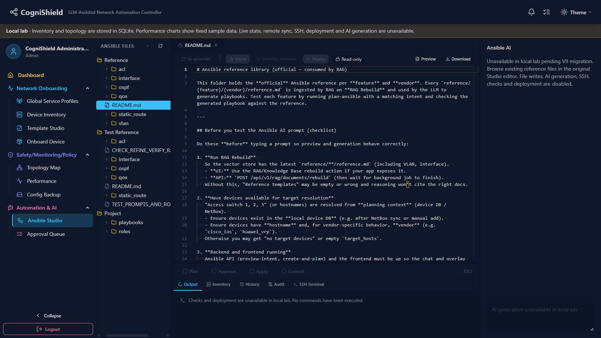

# CogniShield — Migration M0 handover

Verified on 2026-10-10, Windows, in `network_rag_catalog_lab/Net_Topo_View-intentparse`. M0 stops at a working local GUI, SQLite inventory/configuration workflows and explicit integration unavailability. V9 integration and Knowledge Management have not begun. No commit was made.

## Result and scope

The existing CogniShield navigation, inventory forms, topology graph, performance page, snapshot viewer and original Ansible Studio layout remain. The backend starts in local lab mode without remote adapters, scheduler, VM access, SSH or Ansible execution. Local operation needs the Python backend, browser/frontend and SQLite file only.

Browser verification created two disposable devices, edited one, created/edited interfaces and a link, imported/edited a snapshot, restarted Uvicorn and closed/reopened the browser tab, and verified persisted content/topology. All test records were removed through the GUI; their audit history remains. The original R1 record remains. SQLite integrity and foreign-key checks pass.

## Original architecture and mandatory preliminary findings

The required App, Sidebar, AnsibleStudioView, api.ts, backend entrypoint, manager, schema, NetBox API, env example, manifests, lockfile and startup instructions were inspected before implementation. No applicable AGENTS.md was found. The attached original backend env was inspected by variable names only; its credentials were neither printed nor copied.

Original `backend/backend.py` is preserved as [integrated_backend.py](../backend/integrated_backend.py), with identical text apart from newline encoding. Its top-level imports loaded routers and adapters before FastAPI startup. Its `lifespan` (around line 1004) created embedding/vector/agent/pipeline services, SDN and monitoring helpers, a syslog receiver, scheduler, crawl pulse, NetBox retry task and SSH session reaper. The original `/ws` connection also scheduled discovery. A local GUI therefore inherited a remote infrastructure startup graph.

| Dependency | Original relationship | M0 classification and source |
| --- | --- | --- |
| SQLite | DatabaseManager plus several independently constructed relative paths | Required local storage; [manager.py](../backend/db/manager.py), [schema.sql](../backend/db/schema.sql) |
| NetBox / pynetbox | Imported API/client; startup inventory/local-to-NetBox jobs; CRUD background sync; link creation required remote success | Incorrectly mandatory for local inventory; optional normal integration. [netbox/api.py](../backend/netbox/api.py), [client.py](../backend/netbox/client.py) |
| SSH targets / crawler / remote VMs | Startup periodic crawl, websocket-triggered discovery, retry/config helpers | Incorrectly started for a local viewer. Required only for real discovery/execution. [integrated_backend.py](../backend/integrated_backend.py), [scheduler/core.py](../backend/scheduler/core.py) |
| Gemini/Ollama, Chroma/RAG | Agent/embedder/vector-store creation during startup; old Studio AI routes | Optional AI feature dependencies incorrectly coupled to core startup. Deferred in M0. |
| InfluxDB, Telegraf, syslog infrastructure, Prometheus/Grafana | Monitoring adapters, receivers and remote configuration hooks | Optional live monitoring dependencies. Sample charts and stored history available; no collectors/sync in M0. |
| OpenDaylight/SDN controllers | SDN services/controllers in integrated composition | Optional external feature, unavailable locally. |
| Ansible runner/core/lint, netmiko/paramiko | Imported execution stack; checks and deployment require controller/toolchain/targets | Optional execution infrastructure. Not installed for M0. Native Windows is not assumed to be a supported Linux Ansible controller. |
| Monaco CDN / Google fonts | Original editor loader/font resources could require Internet | Removed runtime dependency: Monaco and workers use locked local packages; fonts use existing system fallbacks. |

The old scheduler defines eight jobs: `network_crawl`, `inventory_sync`, `local_to_netbox_sync`, `drift_check`, `compliance_scan`, `security_audit`, `cve_rescan`, `anomaly_detect`. None is registered or started by the local app. Normal-mode integration code remains for later restoration; it was not run or certified in M0.

## Central configuration and startup graph

[lab_config.py](../backend/lab_config.py) is the single mode/path authority:

- `COGNISHIELD_MODE=local_lab` is the default. `normal` explicitly selects the preserved integrated entrypoint. Other values fail immediately.
- Process variables take precedence; project then backend `.env` are loaded without overriding process settings.
- `COGNISHIELD_DB_PATH` defaults to absolute `backend/db/netauto.db`. Relative values resolve under backend, independent of terminal working directory.
- Original remote environment values cannot cause the local composition to start adapters.

`backend.py → lab_config → local_app → reviewed local routers → DatabaseManager → versioned additive migration → SQLite`.

Local lifespan restores a missing canonical database from the populated legacy source using SQLite backup, initializes the existing manager, seeds the existing authentication accounts only when needed, and closes the manager on shutdown. No scheduler, remote driver, embedding model, vector database, SSH pool, controller client or command runner is initialized. The websocket reads local inventory and only polls SQLite while connected. The telemetry websocket announces that live telemetry is unavailable.

Unregistered `/api/v1/*` actions return HTTP 503. Remote sync helper entrypoints have early guards; NetBox client initialization does not import/connect pynetbox in local mode. No timeout-based fallback is used. Capabilities are exposed by `/health` and `/api/v1/lab/capabilities`. Frontend mode is obtained before rendering; it does not silently fabricate data when the backend is unreachable.

## Persistence, migration and preservation

Both original database files were inspected: project `net_topo.db` contained one R1 device; `backend/net_topo.db` contained zero devices. The usual canonical `backend/db/netauto.db` did not exist. M0 copied the populated database through SQLite's backup API, preserving both originals. Final byte comparison against Git HEAD confirms both original DB files are unchanged.

Before schema migration, backup was created at:

`backend/db/backups/netauto-before-m0-local-1-20261010T093050841952Z.db` (90,112 bytes).

[local_migrations.py](../backend/db/local_migrations.py) records `m0-local-1` in `schema_migrations`. It compares the existing schema with the existing `schema.sql`, adds missing compatible columns/tables, then installs [m0_local.sql](../backend/db/migrations/m0_local.sql) in a transaction. No existing tables/rows are dropped or regenerated. Unsupported required-column changes or foreign-key violations stop migration rather than erase data. SQLite backup occurs before changes; repeat startup skips an applied migration.

Reused tables include `devices`, `interfaces`, `links`, `config_snapshots`, `policies`, `policy_audit_log`, `common_service_profiles`, `users`, `device_credentials`, `audit_log`, `jobs`, `job_steps`, `compliance_jobs/results`, `drift_events`, `security_audits/events`, `ansible_chat_sessions` and the other existing schema tables. No competing general database was introduced.

Mutations use parameterized SQL and committed connection transactions. Foreign keys are enabled. New/edited links enforce device/interface ownership, disallow self-links and reused physical ports; interface edits recheck peer compatibility. Interface deletion removes attached links within the transaction. Duplicate device creation now conflicts rather than silently updating an existing record. Hostname, management address/subnet and interface compatibility validation remain/are enforced. Snapshot import validates device existence and content size; deletion respects owner/admin authorization and existing references.

Device/interface/link/snapshot create/update/delete audits are transaction triggers. Policy history uses the existing audit table; policy deletion archives that history in the general audit before cascading. Trigger actor is `local`, not a per-user identity; this is a documented M0 limitation. Device credentials are excluded from these audit details.

## Feature availability and GUI → API → storage trace

All client objects below are in [frontend/src/services/api.ts](../frontend/src/services/api.ts). App routing is in [App.tsx](../frontend/src/App.tsx); sidebar visibility remains in [Sidebar.tsx](../frontend/components/Sidebar.tsx). Endpoint paths below are relative to `/api/v1` unless stated.

| Visible page/component | Client / endpoint | Service and backing source | M0 availability |
| --- | --- | --- | --- |
| Login/profile | authApi → /auth/login, /auth/me, profile endpoints | auth/auth.py + auth/api.py → users, encrypted credential vault | Existing local authentication/profile |
| Dashboard / OverviewDashboard | dashboardApi → /dashboard/summary; netboxApi → /netbox/devices; syslogApi → /syslog/events | local_app queries devices/interfaces/jobs/security/history SQLite | Stored inventory/history; live state explicitly unavailable |
| Device Inventory / NetBoxDevices | netboxApi → /netbox/devices CRUD and /{id}/interfaces CRUD | netbox/api.py → existing DatabaseManager → devices/interfaces | Local CRUD; NetBox sync disabled |
| Device links / existing link modal | netboxApi → /netbox/links GET/POST/PUT/DELETE | netbox/api.py + local_app update → links and interface ownership validation | Local create/update/delete, no remote cable call |
| Topology Map / Dashboard / NetworkGraph / TopologyTable | topologyApi + useWebSocket → /topology, /netbox/topology/planned/local, /ws | SQLite inventory projection from devices/interfaces/links | Stored Inventory tab; live/diff discovery disabled; refresh does not crawl |
| Performance / NetworkPerformance | monitorApi → /monitor/status, /monitor/metrics/dashboard-bundle; thresholdApi → /monitor/thresholds/alerts | local_app deterministic fixture mapped to stored devices/interfaces | Clearly labelled samples; no live availability/alert evaluation; remote sync controls disabled |
| Config Backup / CaptureSnapshotModal | networkConfigBackupApi → /network/config-backup/devices, snapshots, content, diff, download, description; import and snapshot DELETE | network/api.py + local_app → config_snapshots via DatabaseManager | Local import/list/view/diff/download/edit description/delete; capture/restore/AI disabled |
| Global Service Profiles | commonServicesApi → /common-services/* excluding test-* | common_services/api.py + service.py → common_service_profiles | Local profiles; remote NTP/syslog validation unavailable |
| Template Studio | configApi → /config/templates, schemas, render, diff, validate, source CRUD | config_engine API/renderer/differ/validator → local templates and schemas; profiles in SQLite | Existing local editing/rendering; GitHub/remote template sync unavailable |
| Compliance Hub (existing route, sidebar currently commented) | policyApi → /policies/*; compliance results/baseline/snapshots endpoints | compliance/api.py + policy engine → policies, policy_audit_log, compliance_results, snapshots | Local policy CRUD/tests and stored results; collection/scans/remote remediation disabled |
| Ansible Studio / AnsibleFileTree / PlaybookEditor | ansibleApi → /ansible/files and file content | local_app constrained read-only reference/playbook roots | Original tree and Monaco editor render; vault/inventory excluded; file writes disabled |
| Studio History/Audit / JobStatusBar | deployApi → /deploy/jobs, /deploy/audit | local_app → jobs and audit_log | Stored job history/audit; no new execution; SSH tab disabled |
| Studio AI panel | Original ansibleApi/agent/intent/RAG endpoints in normal mode | Old integrated AI/agent pipeline | Honest unavailable panel in original layout; no generation/check/deploy requests |
| Approval Queue | deployApi → /api/deploy/queue (outside v1), normal approval actions | integrated deployment/approval services | Page unavailable; dashboard explicitly says unavailable rather than empty live queue |
| Onboard Device | onboardingApi → /onboarding/* | integrated onboarding/ZTP/deploy/external services | Page unavailable |
| Intent Parser / Intent History / Playbook Comparison | llmApi/agentApi/intentApi/playbookApi | integrated old IntentParser/agent/deployment persistence | Deferred; no V9 replacement yet |
| SDN Dashboard | sdnApi → /sdn/* | controllers/external adapter + sdn_controllers | Unavailable |
| Knowledge Base / old RAG views | RAG/knowledge endpoints | Chroma/embedder/document services | Deferred; Knowledge Management not implemented |
| Device 360 | existing App placeholder | none | Remains existing Phase 2 placeholder |

Backend registration is an explicit reviewed route subset, not mounting the complete integrated router tree. Policy stored-data APIs remain even when their original navigation item is commented; M0 does not invent a new navigation layout. Historical operational rows are retained; creating new live operational results is disabled.

Fixture v1 uses fixed timestamps starting 2026-01-01, CPU series 24/25/26, memory 42/43/44 and fixed traffic values. It contains no random measurements or current-time substitution. Its device names and interfaces come from SQLite. Charts are sample operational state, never proof that a device is reachable. Inventory status is user-managed metadata. Packet data absent from the fixture remains unavailable.

## Installed dependencies and exact commands

Installation was actually performed. Python uses isolated `backend/.venv-m0`, created with existing CPython 3.14.0. Node 24.11.0 and npm 11.6.2 were already installed. The frontend lockfile was valid; authorized `npm ci` installed 490 locked packages without package/lockfile upgrades.

Required local Python input is [requirements-local.txt](../backend/requirements-local.txt); exact installed transitive versions are captured in [requirements-local.lock.txt](../backend/requirements-local.lock.txt). Key versions: FastAPI 0.143.0, Uvicorn 0.54.0, Pydantic 2.14.0, Starlette 1.7.0, websockets 17.2, python-dotenv 1.2.4, python-multipart 0.0.32, bcrypt 3.2.0, python-jose 3.5.0, cryptography 50.0.2, Jinja2 3.1.6, jsonschema 4.26.0, PyYAML 6.0.3, httpx 0.28.1, pytest 9.1.1. No model weights or Linux controller toolchain were downloaded.

Frontend exact transitive versions remain in the original package-lock.json: Vite 7.2.2, TypeScript 5.9.3, React 19.2.0 and Monaco Editor 0.55.1. No version upgrade was performed. Full `backend/requirements.txt` is retained as optional normal integration dependencies, with its misleading Windows Ansible comment corrected.

From the application root, installation/reproduction commands are:

~~~powershell
C:\Python314\python.exe -m venv backend\.venv-m0
backend\.venv-m0\Scripts\python.exe -m pip install -r backend\requirements-local.lock.txt
Set-Location frontend
npm ci
~~~

The initial installation used `pip install -r requirements-local.txt`, then `pip freeze` captured the exact lock above. Network/sandbox limitations required approved unsandboxed installs. No environment-wide packages were installed.

Start in two PowerShell terminals:

~~~powershell
Set-Location 'C:\Users\limmi\OneDrive\Desktop\LLM_RAG_Practice\network_rag_catalog_lab\Net_Topo_View-intentparse\backend'
.\run_local.ps1
~~~

~~~powershell
Set-Location 'C:\Users\limmi\OneDrive\Desktop\LLM_RAG_Practice\network_rag_catalog_lab\Net_Topo_View-intentparse\frontend'
npm run dev -- --host 127.0.0.1
~~~

Open http://127.0.0.1:5173/. Backend is http://127.0.0.1:8000/health. Use the existing local account; credentials are intentionally absent from this handover. The script sets local mode explicitly and binds loopback. Do not run the legacy integration instructions for M0. To use an existing alternative DB, set COGNISHIELD_DB_PATH before launching; its additive migration will back it up first. Do not overwrite or delete the original databases.

## Actual verification

| Check | Outcome |
| --- | --- |
| Python imports / Uvicorn lifespan | Passed with minimal venv; remote execution packages absent; pip check reports no broken requirements |
| Remote isolation | Tests forbid socket.create_connection and subprocess.Popen, inspect imported modules, assert empty remote jobs and HTTP 503 on external actions; no remote adapters launched |
| Navigation and dashboard | Loaded in real in-app Chromium browser, original navigation retained |
| Device CRUD | Browser created M0-browser-a/b at documentation-range IPs, renamed/edited a, listed and deleted both |
| Interfaces/links | Browser created management + additional interfaces, renamed Ethernet1 to Ethernet2, created and edited link; automated ownership/duplicate/compatibility rejection and cascade checks pass |
| SQLite restart persistence | Stopped PID 22780 and launched fresh Uvicorn PID 22176; closed/reopened app tab; snapshot content, devices, interfaces and topology link remained |
| Configuration snapshots | Browser import, view, description update and delete passed; restore and AI disabled |
| Stable telemetry | Browser refresh retained CPU 24%, memory 42%, fixed chart times; automated complete payload equality across refresh passes |
| No real execution | No checks, deployment, SSH or device commands executed; unavailable routes fail closed |
| Original Ansible Studio | Original file tree/editor/status area renders; local Monaco opens reference README; disabled AI/execution state visible; Audit tab displays committed CRUD history |
| Isolated backend tests | 10 passed, one dependency deprecation warning |
| Production build | TypeScript + Vite passed; CSS @property and large bundle warnings remain |
| Frontend lint | Fails: 546 errors / 35 warnings. Original HEAD baseline: 570 errors / 36 warnings. Most are 474 existing no-explicit-any findings; new mode/Monaco modules have zero findings. No lint rules were disabled. |
| Original DB preservation | Both original DB files match Git HEAD byte-for-byte; canonical DB integrity_check=ok and foreign_key_check empty |
| Cleanup | Zero M0-browser devices remain; original R1 retained; audit of test CRUD retained; no repository mass deletion |
| V9 and unrelated changes | No V9 tracked-file changes; pre-existing untracked V9 documents/images and workspace README retained; no commit |

Commands used:

~~~powershell
# backend directory
$env:PYTHONPATH=$PWD
.\.venv-m0\Scripts\python.exe -m pytest tests/test_m0_local.py tests/unit/test_policy_compliance_engine.py tests/unit/test_compliance_scope_resolver.py -q
# frontend directory
npm run build
npm run lint -- --format json --output-file ../docs/m0-eslint-results.json
~~~

Lint output was reduced to a source-free compact summary in [m0-eslint-results.json](m0-eslint-results.json); [m0-eslint-baseline.json](m0-eslint-baseline.json) records the original-source comparison using the same installed ESLint configuration. TestClient needed approved execution outside the sandbox because Windows socketpair stalled inside the sandbox before application startup. The complete remote integration test suite was not run. Normal mode and remote services were not certified. Browser restart here means closing/reopening the application tab, not terminating the entire user's browser process.

## File classification and deferred cleanup

| Category | Files / reason |
| --- | --- |
| Active local | backend.py, lab_config.py, local_app.py, local migrations, existing db/auth/network/inventory/compliance/profile/config services; frontend main/App/sidebar and existing visible views |
| Necessary shared | schema/models/manager, RBAC/vault, policy engine, template renderer/validator, API client/types, graph/table/modals/Monaco components, existing templates and schemas |
| Disabled/deferred, preserved | integrated_backend.py; scheduler; crawler; drivers; NetBox sync modules; monitor collectors; SDN; SSH; Ansible runner/builder; LLM/RAG/agent; old IntentParser; onboarding/approval/GitHub paths |
| Cleanup candidates, not deleted | frontend/components/ansible/AnsibleChatPanel.tsx.bak; commented Sidebar/App entries and commented handlers (layout reset, preview, onboarding revert, preview cache); old source/export scratch files and alternate legacy entrypoints require a reference review after V9 contracts are verified |
| Proven runtime-unused artifacts | The .tsx.bak file is not an imported TypeScript module; generated build output and dependency caches are rebuildable. They were not mass-deleted. Backups/databases are retained data, not deletion candidates. |

The startup inventory above includes background jobs and websocket entrypoints, not only visible routes. No global “unused” claim is made for old subsystems: they remain dependencies of normal mode or planned V9 replacements.

## Remaining limitations and next single phase

M0 is a local prototype, not a live network controller. AI, Knowledge Management, real telemetry, device capture/restore, scans, remote Git sync, SSH, Ansible execution and approval actions remain unavailable. Normal mode requires its separate integration dependencies and infrastructure. Local template source files remain filesystem-backed by the existing Config Engine; inventory/configuration snapshots/policies use the existing SQLite manager. Historical records remain readable where the existing UI supports them.

Existing lint debt and large Monaco-inclusive bundle remain. The Starlette TestClient httpx deprecation warning was retained without an unapproved dependency upgrade. Existing authentication defaults/security model were not redesigned. Audit triggers record local mutations but do not identify the individual account. Some secondary old UI controls can still surface a truthful 503 instead of being individually hidden. No fake execution success is returned.

Recommended next phase only: define and verify the V9-to-CogniShield adapter contracts for the existing Ansible Studio/intent workflow, using the preserved SQLite inventory and local execution-denial boundary. Inspect V9 read-only, map request/response schemas, then implement the smallest adapter behind tests in a separately authorized phase. Defer Knowledge Management and destructive cleanup until those replacements are verified.

