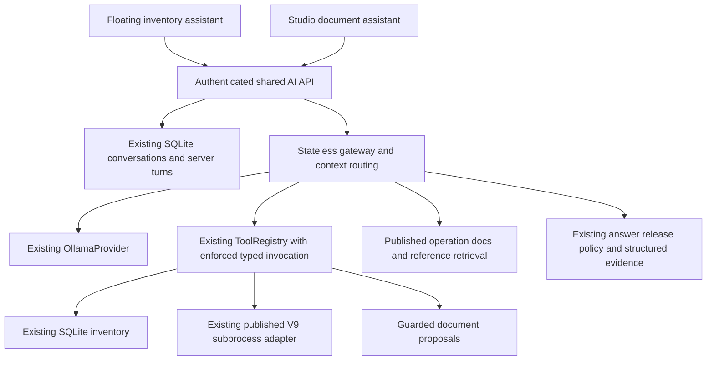

# Shared AI A0–A5 implementation record — 2026-10-15

This is an additive implementation record. The existing audit, checkpoint, M0/M4 handovers, Knowledge Engineering workflows and A0–A5 requirements remain applicable. The sibling `../network_rag_catalog_v2` remains read-only. No ordinary database migration, ordinary release publication or device execution was performed during this work.

## Delivered behavior and remaining enablement

| Iteration | Implementation | Acceptance and limits |
|---|---|---|
| A0 | Authenticated shared local gateway, per-request Ollama provider, separate owner/surface-bound SQLite conversations, typed inventory, cancellation/idempotency and passive diagnostics; floating launcher restored. | Inventory browsing does not require Ollama. Missing models produce unavailable responses. No inference-time installation. Startup migration is backed up/idempotent and was applied only to disposable databases here. |
| A1 | Studio captures the actual Monaco model, unsaved content, selection, identity/version/epoch and saved revision. Explanation and engineering Q&A share the provider and bounded published/reference retrieval. | Explanation routes create no jobs or file changes. Explicit read-only wording constrains model routing. The installed qwen2.5:1.5b produced an inaccurate comment explanation in one live attempt; passing context transport does not establish answer accuracy. |
| A2 | Conversation-owned attachments, streamed upload bounds, strict text decoding, bounded child-process PDF extraction, retained follow-up context and page/line/content references. Retained files can be explicitly opened as unsaved text documents. | YAML/YML, Jinja2, CFG/CONF/TXT, JSON, LOG, Python and PDF supported. 5 files/turn, 10 MiB/file, 25 MiB/turn, 30 retained files/100 MiB/conversation, 1 MiB extracted text, 200 PDF pages. PDF requires an existing configured interpreter with pypdf. No OCR or encrypted PDF support. Relevant excerpts report incomplete coverage. |
| A3 | Shared gateway invokes the existing published V9 adapter. Parameter/operation/target review, native drafts and explicit save are separate from the optional playbook path. Site/location/aliases and source-referenced engineering facts extend the existing inventory and are editable in Device Inventory. | One operation/target only; inventory and published-release guards remain. Full 47-operation assessment is recorded below. Missing bindings/versions/variants/facts remain unsupported. The legacy IOS-XE wrapper remains a compatibility workflow, not evidence of a newly verified A5 variant. |
| A4 | Typed proposal capability, exact unique nonoverlapping patches, YAML/JSON/Python/Jinja structural checks, inline Monaco review, Accept/Reject, undo boundaries and CAS saving. Native documents use the existing V9 VLAN-name editor. | Accept changes only the buffer. Save is explicit. Stale buffer/model/revision responses are rejected and approved artifacts remain locked. The verified native-edit adapter is **Cisco IOS-XE VLAN rename only**; other native operations/vendors require a reviewed adapter and fail explicitly. General code editing is limited to 64 KiB. |
| A5 | CogniShield-owned optional playbook variant authoring API, staged immutable packaging, exact operation/binding/fixture/module/plugin/dependency contracts, and a fail-closed WSL validation launcher. | **Enablement is incomplete in this environment:** no approved bubblewrap/tool profile, contained Ansible validation pass, or newly reviewed playbook variants are available. Therefore the new playbook path remains unsupported/unavailable. No variant was fabricated, dependency installed, or ordinary release republished to change this status. |

Original safety requirements remain: explicit review, role/resource checks, isolated tests, approved-artifact locks, immutable releases, V9 source protection, revision-checked saving, local operation, native/playbook separation, checkpoint updates, and no A6/device execution. Syntax/lint, compatibility, semantics, device testing and deployment authorization remain distinct fields.

## Ownership and request flow



Primary code locations are `backend/llm/gateway*.py`, the extended `backend/llm/tools.py`, and the existing `backend/local_providers/{chat,authoring,v9_studio,v9_worker}.py`. Both local UI surfaces call `frontend/src/services/ai.ts`. Normal-mode integrations remain in place. No shared mutable `NetworkAgent` instance or second operation recognizer was introduced. LangChain remains inside V9's existing integration; LangGraph orchestration was not adopted.

`/api/v1/ai` supplies conversations/turns, cancellations, inventory, attachments, explicit document saving and V9 review/rendering. Legacy Studio chat endpoints remain owner-checked Studio façades; authoritative inference history comes from server-produced turns, not client-submitted transcripts. New shared requests forbid extra fields. Existing authenticated principals and roles determine authority; submitted profiles, tool names, message roles or approval fields cannot grant permissions. Runtime-model selection no longer mutates another caller's process default; shared turns resolve their model per request.

Floating Chat registers only inventory reads for its A0 scope. It rejects editor snapshots and attachments and has no proposal/write/publication/execution capability. Studio proposals use engineer/admin authorization and resolve document paths, locks and revisions on the backend. Save and privileged Knowledge Engineering publication remain separate endpoints. Authorization is rechecked on proposal-response cache reuse. All device execution remains disabled in local mode.

Evidence separates source identity/revision, device references, captured/retrieved times, requested range, freshness, origin and time scope. Inventory facts are stored structure; their read time does not establish reachability. Unavailable measurements are never replaced with zero. Model text and uploaded files do not become authoritative server evidence. The reused answer-release policy describes recorded evidence availability, not proof that the generated prose is correct.

Engineering facts use the backed-up additive `shared-ai-2` migration on the existing `devices` table. The typed contract allows an explicit `planned` or `sample` origin, model family, nonempty source references, capabilities, planned VLANs, existing-interface facts and resource snapshots, bounded to 100 KiB. Explicit saving requires engineer/admin authorization and a matching content revision; identity/vendor/version cannot be overwritten through facts, and interface names must exist in SQLite. V9 independently validates these facts against its published policy. Empty/unknown facts stay empty. The acceptance runner deliberately supplies a source-labeled sample Catalyst 9300 VLAN profile; no such facts are added to ordinary inventory.

## Knowledge authority and retention

The read-only report is reproducible with:

```powershell
.\backend\.venv-m0\Scripts\python.exe -B backend/scripts/assess_ai_coverage.py
```

See [complete assessment](shared_ai_coverage/assessment.json) and [282-row coverage matrix](shared_ai_coverage/coverage.csv): 47 operations × 3 vendors × 2 separately identified environments, including platform/version lists and native/playbook/edit status. Both active manifests and their declared artifact hashes are verified. Index operability is not asserted by this inspection.

| Environment | Active release | Operations / bindings | Authority |
|---|---|---|---|
| Ordinary | `0690966eb003499380e960a98d1e418f` | 44 / 78 | Configured ordinary workspace only; offline retrieval manifest is not ready. |
| Isolated M4 | `c90cf63a5f9342528c5014125778c233` | 47 / 81 | Test workspace only; release-specific Chroma index is declared, operability not reverified here. |

The isolated additions are the management-security category, three operations, six management parameters and three Cisco bindings. There is also a seventh added parameter, `lab_label`: isolated `create_vlan` changes from version 1 to 3, requires this field, alters all three input contracts and changes the Cisco VLAN-name template. These are incompatible test changes, not an ordinary migration candidate.

Preserve both environments unchanged. Keep `lab_label` and the test VLAN contract as fixtures. Any later adoption of the three management operations requires separately authorized reconstruction through the existing authoring API against a copy of ordinary knowledge, dependency/fixture checks and a newly reviewed release. Never copy isolated SQLite files, release folders or pointers into ordinary knowledge. The V9 active pointer stays `{release_id, manifest_sha256}`; framework state never replaces it.

## Optional validation and playbook profile

WSL supplies Linux only. `gateway_validation.py` returns unavailable until an explicitly configured `/opt/cognishield-validator/...` profile can pass the worker checks. The worker rejects root, requires bubblewrap, clears inherited environment, isolates networking/processes/mounts, supplies staged inputs and read-only tools, and tests absence of Windows mounts, home credentials and network connectivity. It applies CPU/address-space/process/file/output/time limits; it does not claim deployment safety. No containment pass was obtained on this machine.

A profile must contain `profile.json` with exact collection `dependencies` and SHA-256 `files` for the complete tool/collection tree. Installed collection `MANIFEST.json` versions must match. `bin/python`, `bin/ansible-playbook`, `bin/ansible-lint` and `bin/ansible-doc` must be integrity registered. Required module/connection/cliconf/netconf plugins must resolve inside containment. Syntax checking uses a staged local inventory; lint runs `--offline` with controlled configuration. Tool provisioning is a separate administrator activity, not inference behavior. Deprecated `community.network` remains reference material and cannot enable a new variant. Huawei enablement requires explicit maintained, pinned plugins and device-specific review evidence.

`PUT /api/v1/knowledge/playbook-variant` authors a draft using existing knowledge locking, revision and audit behavior. Optional variants freeze only inside an unpublished staging package. Existing releases without this extension remain readable. Publication requires an exact schema-valid fixture, matching expected YAML and a contained syntax/lint pass with the declared dependency versions. Native bindings are untouched and continue independently when playbook tools/variants are absent.

Relevant upstream constraints: [WSL interoperability](https://learn.microsoft.com/en-us/windows/wsl/interop), [ansible-lint offline behavior](https://docs.ansible.com/projects/lint/usage/), [LangGraph interruption/replay](https://docs.langchain.com/oss/python/langgraph/interrupts). The previously observed LangGraph 1.2.11 is not upgraded to obtain newer typed-interrupt features. Framework adoption requires a bounded comparison preserving authorization, provenance, cancellation, local operation and V9 authority; no cloud tracing is required.

## Reproduction and evidence

The installed backend runtime is `backend/.venv-m0`; V9 retains its separately configured existing interpreter. Startup checks do not install missing dependencies.

```powershell
# Passive diagnostics: no lifespan/migration/publication
.\backend\.venv-m0\Scripts\python.exe -B backend/diagnose_local.py
# New disposable acceptance database, copied immutable ordinary release, two devices
.\backend\.venv-m0\Scripts\python.exe -B backend/scripts/serve_ai_lab.py --port 8002
# Existing acceptance workspace can be reused only under tmp/shared-ai-*
.\backend\.venv-m0\Scripts\python.exe -B backend/scripts/serve_ai_lab.py --workspace tmp/shared-ai-9bn22lf5 --port 8002
```

For the acceptance frontend, set `VITE_API_URL=http://127.0.0.1:8002` and `VITE_WS_URL=ws://127.0.0.1:8002`, then use the existing Vite dev command on port 5176. The acceptance runner's CORS allowlist is limited to that local origin, including private-network preflight. The ordinary local app allows its existing explicit localhost development origins; other origins are rejected and shared AI still requires authentication. Optional PDF tests used the already bundled runtime via `COGNISHIELD_DOCUMENT_PYTHON`; `.env` was not edited and no package was installed. Ordinary startup will apply the backed-up additive shared-AI migration when the user starts the updated local backend; this implementation session did not restart/migrate the ordinary application.

Verified checks during implementation:

- Local workflow/presentation/artifact/shared/variant set: 30 tests and 7 subtests passed before the final added safety cases; an obsolete M0 telemetry fixture and service-check expectation were corrected in the test, preserving its socket/process guards.
- Latest focused shared-AI/variant/PDF/approved-lock set: 24 passed; this includes 16 shared-AI tests.
- Real PDF child-process extraction and invalid-PDF rejection: 2 passed using the existing pypdf runtime.
- Existing V9 end-to-end bridge: 1 passed, including clarification, corrected parameters, rejection, artifacts, ownership, audit, restart and blocked execution, against disposable knowledge/SQLite only.
- Browser: grounded local inventory response; Python proposal preserved an unsaved comment; Accept changed the buffer; Undo restored the exact previous buffer; explicit Save succeeded. New native VLAN generation preview rendered `vlan 100 / name STAFF` from ordinary published knowledge and opened an unsaved draft before Save.
- Browser native editing: missing hardware/capability facts were rejected. With the explicit sample profile, the existing IOS-XE V9 rename adapter proposed STAFF → ENGINEERING; Reject left the buffer unchanged. The V9 literal guard requires exact values: quote a name when sentence punctuation would make its token ambiguous. No policy or literal guard was weakened.
- The installed small model once selected the playbook route despite explicit native wording; missing variants were correctly rejected, and explicit native selection still worked. A tested server constraint now honors explicit native/playbook and read-only preferences.
- Final combined regressions: **38 passed and 7 subtests passed**, including the real PDF worker; existing V9 live bridge: **1 passed separately**. Only the inherited Starlette/httpx deprecation warning remains in these tests.
- Final TypeScript/production build passed (3,951 modules, 19.89s); inherited CSS `@property` and bundle-size warnings remain.

Final reconnect checks restored separate Floating history and Studio history. Floating initialization independently loads inventory, conversation and model state, ignores obsolete initialization results, and can refresh after failure. Read requests get at most one retry on a connection failure; mutations/inference are not retried by the fetch wrapper. Monaco review models detach before disposal; the last Reject retained the unsaved marker and produced no new model-disposal error. Source parsing checked all 34 modified/new Python files; scoped whitespace and sibling-source checks passed.

Screenshots and disposable app state are under `tmp/shared-ai-*`; final native review proof is `tmp/shared-ai-native-review.jpg`, unsaved-reading proof is `tmp/shared-ai-unsaved-context.jpg`, and read-only release/SQLite verification is `tmp/shared-ai-verification.json`. Generated durable coverage is under `docs/shared_ai_coverage`. No automatic commit or ordinary promotion was made.

## Explicit deferrals and handoff contract

F1 structured inventory, F2 topology/path, F3 live/historical telemetry, F4 Floating RAG, F5 multi-tool investigations, F6 anomaly/forecast integration, and F7 engineering handoff remain design-only. Studio retrieval does not enable Floating RAG. ML training, autonomous remediation, A6/cross-file edits, multi-target orchestration and device execution remain excluded.

The typed `EngineeringHandoff` is a contract only; no route/button/workflow is enabled. Future F7 must construct server evidence/device references and timestamps, requested action and release-bound candidate hints; show a reviewable record; recheck ownership/access/source revisions; idempotently create a distinct Studio conversation; and require the user to send the engineering request. Acceptance transfers no authority and triggers no generation, document change, publication or execution. V9 independently resolves current inventory and published parameters. Cross-user handoff and automatic Monaco insertion are excluded.

Next enablement work is concrete: provision and verify an isolated pinned validator separately, author/review real playbook variants, expand native edit adapters only with evidence, and evaluate a suitable installed model against the saved acceptance cases. These are not reported as already verified capabilities.
