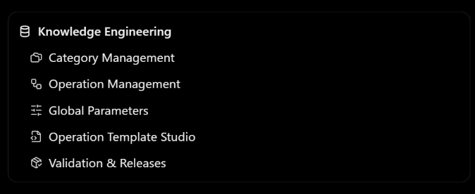
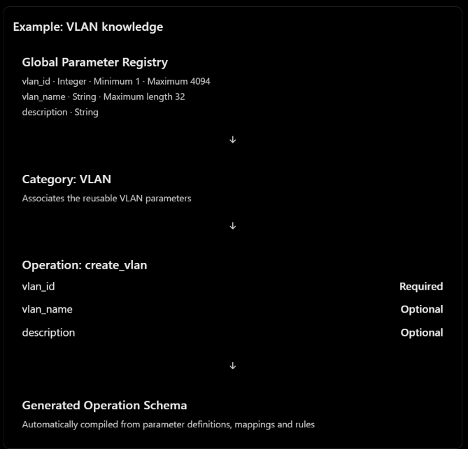

# CogniShield engineering roadmap and resume checkpoint

## Resume here

### Latest visual continuation — 2026-10-12 12:30 +08:00

Knowledge Engineering reference matching is **IN PROGRESS, not visually accepted**. The user now requires strict matching of the images in `docs/reference_images`, including panel contents/proportions, colors, overlays and syntax highlighting. The previous approximate layouts are insufficient. User selected **a separate reference-data preview**, preserving the live catalog, and said they will specify authoritative filenames for the folders containing alternatives. A question is pending for Global Parameters (`global parameters_sample 1/2/3.png` or `c63c8c90…png`), Templates (`template_sample 1/2/3.png`), and Validation & Publication (`validation & publication 1/2.png`). Do not assume the previously proposed images were accepted. Categories, Operations and Overview have one image each.

Current frontend changes: `frontend/views/KnowledgeEngineeringView.tsx` and new scoped `KnowledgeEngineering.css` contain bounded viewport grids, internal scrollports, contained drawers, grouped vendor/platform/version trees, and operation template preview. These preserve existing API mutations. Six populated views and the parameter drawer were visually inspected in a temporary disabled-mutation harness using an existing isolated catalog snapshot; this verifies containment for those inspected screens, **not exact reference fidelity or live save/publication**. The temporary harness files were removed. No user records or sibling V9 files were changed.

Verification: unused ChevronRight import fixed; TypeScript passed. Initial Vite build hit sandbox EPERM on index.html; authorized build passed (3938 modules, 36.82s), with existing CSS @property/chunk-size warnings. No backend tests rerun for these frontend-only edits. Known visual gaps include reference-specific panels/actions and the template syntax colors (handlebars language is currently not registered by monacoLocal). Next: obtain the user's three filenames, implement those exact reference layouts plus a clearly labeled reference-data preview, retain functional live catalog controls, then compare rendered screens against those selected images. Do not claim Idea 2 or strict visual matching complete.

Last checkpoint: **2026-10-12 01:33 +08:00 (Asia/Kuala_Lumpur)**.

This is the central resume record. The original engineering ideas below are preserved as the target design; they are not a claim that those features already exist. Idea 1 now has one verified V9-backed vertical slice. Knowledge Engineering is **partially implemented**; see the Idea 2 checkpoint below.

| Item | Current state |
| --- | --- |
| Working application | `network_rag_catalog_lab/Net_Topo_View-intentparse` |
| Current runtime | CogniShield local SQLite/JSON providers; Studio selects the V9 create_vlan bridge through .env; original adapter preserved |
| Restored Studio path | Original preview, editable parameters, comparison, generated YAML + review Markdown, and Monaco editing verified for one VLAN workflow |
| V9 runtime adapter | **VERIFIED**: published create_vlan vertical slice (Cisco IOS-XE 17.9 representative device) |
| Knowledge Engineering GUI | **PARTIAL**: separate management navigation, catalog drafts, template variants, compilation and offline publication; focused tests/build passed; browser catalog/publication passed, Monaco typing unverified |
| Next action | Continue remaining Idea 2 requirements listed below; do not restart the completed authoring/publication foundation |
| Current in-progress changes | V9 worker/adapter, session migration and GUI contract mapping implemented; focused backend check, frontend build and browser clarification/modal/generation/Monaco passed. |
| Runtime processes | Availability must be checked on resume; previous PIDs/terminal sessions are not reliable across sessions |

### Verified baseline to preserve

- SQLite remains the authority for application records and authoring revisions. Editable validated JSON supplies simulated external observations and configuration responses.
- Local Ollama is `http://127.0.0.1:11434`; installed chat model last checked: `qwen2.5:1.5b`. Actual inference through the Studio provider returned `connected`.
- Original Ansible Studio generation was restored by removing the all-requests local chat shortcut. Authoring reaches the original preview/generation services; explanation requests still use chat.
- Browser verification: VLAN 10 named Art on R1 → original interpretation/parameter modal → Confirm & generate → reference/generated comparison → Confirm & use → Monaco. Generated Job 3 has YAML and `preview_modal_dialog.md`; an editor comment was saved and reopened. No deployment or approval decision was performed.
- The representative VLAN uses the original deterministic parser/reference renderer. It is **not evidence of V9 integration or LLM-driven interpretation for every request**.
- Config Backup's status indicator now recognizes `up`; R1 displayed the green `bg-success` state.
- Existing inventory, historical snapshots, unrelated unsaved editor content, and baseline source templates were preserved.

### Exact last verification and limits

| Check | Recorded outcome |
| --- | --- |
| `backend/.venv-m0/Scripts/python.exe studio_generation_smoke.py` | Passed with temporary SQLite: preview, generation, YAML edit, Markdown save, application lifespan restart/reopen, and execution blocked. Initial sandbox run stalled; authorized local run passed. |
| Original Studio provider → installed Ollama | Real inference passed separately. |
| `npm run build` from `frontend` | Passed; 3936 modules, inherited CSS/chunk-size warnings. |
| Browser Studio workflow | Preview, comparison, generated editor, save/reopen and companion Markdown passed as above. |
| Browser backup indicator | R1 online dot verified green. |
| Full platform acceptance / all vendors | **Not claimed complete**. Earlier module-specific limitations remain in the consolidated handover. |
| Actual remote mode | Preserved, but not verified against the unavailable infrastructure. |

Known remaining limitations: the local Studio job-inventory subpanel route is not mounted; real Ansible lint/check/deploy is unavailable; local structural/safety checks still run. Model quality depends on the installed model. A detached backend process stopped and a Windows socket error occurred during verification; a retained supervisor terminal restored connectivity. Do not infer a persistent runtime fix from that recovery.

### Focused source map (start here, not with a repository-wide re-audit)

| Concern | Existing source / record |
| --- | --- |
| GUI authoring request and clarification | `frontend/components/ansible/AnsibleChatPanel.tsx` |
| Original preview, parameters and generated comparison | `frontend/components/ansible/PlaybookStudioOverlay.tsx` |
| File Explorer, tabs and Monaco | `frontend/views/AnsibleStudioView.tsx` |
| Original backend generation contract | `backend/ansible/api.py`: `/ansible/preview-intent`, `/ansible/create-and-plan` |
| Current local bridge | `backend/local_providers/studio.py`, `backend/local_app.py` |
| SQLite authoring authority | `backend/local_providers/authoring.py`, existing `authoring_revisions` |
| Original intent/model integration | `backend/llm/intent.py`, `backend/llm/ollama_provider.py` |
| Environment selection/startup | `backend/lab_config.py`, `backend/backend.py`, `backend/run_local.ps1`, `backend/run_environment.py` |
| Local/normal preservation reference | `backend/integrated_backend.py` |
| Detailed completed work and evidence | `docs/M0_2_M0_3_HANDOVER.md`, latest Studio continuation section |
| Earlier foundations (only if needed) | `docs/M0_HANDOVER.md`, `docs/M0_1_HANDOVER.md` |
| Original UX reference supplied by user | `C:/Users/limmi/OneDrive/Desktop/generation process.pdf` |

Root `.env` last selected `COGNISHIELD_MODE=local_lab`. The configured database `backend/db/m0_2_m0_3_browser_smoke.db` contains **real user data despite its name**. Never delete/regenerate it or use it as disposable test cleanup. Last local model setting was `COGNISHIELD_LOCAL_OLLAMA_MODEL=auto`; startup may rediscover the installed model. Do not copy credentials or full `.env` contents into this record.

### Editable simulation locations

All paths below are relative to `backend/simulation/`. Save a valid file and refresh the relevant GUI page. Match SQLite device/interface IDs; JSON must not create a competing inventory.

| Input | Purpose |
| --- | --- |
| `observations.json` | Shared observation defaults |
| `availability.json` | Active/inactive and up/down/unknown device state; interface overrides |
| `metrics/1h.json`, `metrics/6h.json`, `metrics/24h.json` | Deterministic CPU, memory, traffic, errors/discards and packet metrics |
| `syslog.json` | Syslog and network events |
| `alerts.json` | Alert observations and calculated threshold inputs |
| `configurations/device-<SQLite ID>.json` | Per-device current configuration; currently device-1 and device-2 files |
| `workflow_outcomes.json` | ZTP/restore outcomes and new-device configuration defaults |

Schemas and editing examples: `backend/simulation/README.md` and adjacent `*.schema.json` files. `observations.before-split.json` is recovery-only, not an active provider input. Captured snapshots/history remain SQLite records; editing current configuration JSON does not rewrite past snapshots.

## Idea 1 implementation sequence (first slice completed)

**Idea 1 first; Idea 2 follows only after a verified runtime vertical slice.** Do not expand the old parser into another long-term engine. Preserve its source and working baseline until replacement parity is demonstrated.

1. At the next implementation request, read this checkpoint and the latest user instructions. Inspect only relevant changed files/Git status; do not revert unrelated changes or assume a clean checkout.
2. Read-only inspect the sibling `network_rag_catalog_v2` entry points and completed V9 integration contracts. The statements in the roadmap about V9 classes/releases remain design inputs until checked against that source. Do not modify or move the sibling repository under the existing preservation constraint.
3. Record the smallest integration decision: V9 runtime invocation, session/clarification state, inventory bridge, published knowledge authority, and existing API response mapping. Resolve how CogniShield revision overlays relate to published V9 templates before enabling knowledge editing.
4. Connect one supported request behind the existing Studio API. Preserve all returned tasks or explicitly reject unsupported multi-task output; never silently drop tasks. Revalidate modal edits through V9.
5. Produce an artifact with an explicit output format. Native CLI is not an Ansible playbook; use compatible existing building/validation logic or published templates without a competing intent engine or schema compiler.
6. Save the artifact and companion explanation using existing persistence and open it in Monaco. Verify one representative clarification/edit/generate/save/reopen workflow, then record actual results and stop at the agreed milestone.
7. Only afterward begin the senior Knowledge Engineering pages on V9's existing authoring/compilation/publication contracts.

## Checkpoint maintenance protocol

Update this document at meaningful completed steps and before a known handoff, rather than appending every tool call. Preserve the original engineering ideas below. Keep the current-state section concise and move detailed evidence to the existing handover when needed.

For each update record:
- Local timestamp and the specific milestone being worked on.
- What actually changed, with exact file/service references.
- State: **pending**, **in progress**, **implemented but unverified**, **verified**, or **blocked**.
- Exact relevant verification command/result; distinguish current evidence from historical results.
- Remaining blocker and the smallest next action, including any unsaved work or running process needed.
- Decisions already settled so they are not repeatedly reassessed.

Do not mark a phase complete merely because its page renders or an earlier phase passed tests. Rerun checks only for relevant changes/failures. Never record secrets. Preserve user data, normal-mode adapters and unrelated Git changes; do not automatically commit, clean up legacy code or upgrade dependencies.

If interrupted before a checkpoint can be written, the next session should inspect only the focused diff and relevant output after this checkpoint. This file aids recovery but cannot guarantee recording an abrupt interruption or persistent cross-chat memory. Explicitly reference this path when resuming in a new chat.

### Integration decision — current

User authorized Idea 1 implementation on 2026-10-11. V9 is read-only and runs in an isolated worker using the existing workspace Python environment, with bytecode disabled and writes to the sibling prohibited. Published release authority is required (no direct-file fallback); SQLite inventory is exported into request-local context, not a second editable inventory. Initial supported output is one Cisco IOS-XE create_vlan task: V9 validates/renders native CLI; a typed Ansible resource playbook represents the same validated operation. Multiple tasks/other operations must fail explicitly. Old Template Studio revisions do not modify published V9 knowledge. Knowledge Engineering remains deferred.

### Idea 2 checkpoint — 2026-10-12 01:33 +08:00 (partial implementation)

User authorized Knowledge Engineering. First bounded deliverable: V9-managed SQLite drafts, structured catalog editing, bound native-template Monaco editing, V9 validation/compilation, explicit admin offline publication, and the same Studio consuming that local published release. Sibling remains read-only. Existing Template Studio revisions do not modify V9 drafts.

Implemented `local_providers/knowledge.py` (authenticated routes), `knowledge_worker.py` (existing V9 service hosting), and `KnowledgeEngineeringView.tsx`. V9's own catalog.sqlite3 is hosted under CogniShield `backend/knowledge_workspace`; this is the existing V9 repository schema, not a replacement catalog engine. An additive `cognishield_template_revisions` table supplies missing template text revisions to V9 snapshots, transactions and publication. Existing database is backed up before this additive table; V9 migration also retains the imported JSON baseline. Runtime selects the managed active release once initialized, and fails closed if it is missing; no draft/source fallback. Initialization imports only the verified published baseline.

Focused isolated check `backend/.venv-m0/Scripts/python.exe backend/tests/test_knowledge_authoring.py` PASSED: draft isolation, invalid Jinja/path rejection, revision conflict, operation version bump, administrator-only publication, published native template consumed through original Studio API, audit and restart persistence. Route ordering initially intercepted knowledge API with the remote fallback; corrected before the passing run. Frontend build and partial browser acceptance completed; see continuation below.

Explicit remaining scope: V9 TemplateBinding has no output-format dimension; this iteration edits existing native CLI bindings, not arbitrary Ansible/Terraform formats. Offline publication supplies release-specific retrieval documents but no semantic Chroma index. Advanced conditional/nested rule form editors and full binding/operation creation UX remain follow-ups; no claim that all of Idea 2 is complete.

### Idea 2 continuation: separate management pages and actual results

User clarified a dedicated sidebar section alongside Network Onboarding, Safety/Monitoring/Policy and Automation & AI. Implemented **Knowledge Engineering** with **Categories**, **Operations**, **Global Parameters**, and **Validation & Publication** entries. Categories attach global parameter pools; operations independently map fields and Required checkboxes. Operation details can now be created/edited; new operations start inactive. Engineers use forms for numeric/length/array-size/pattern constraints and a read-only V9-compiled schema preview. Global parameter types include string/integer/number/boolean/array/object/null; JSON structures use object/array.

Templates: operation -> vendor -> platform -> explicit software versions. Existing templates open in Monaco; new variants use server-generated paths under `data/templates/<vendor>/<category>/<operation>/<platform>/<id>.j2`. Template text and history are SQLite revisions, not filesystem mutations. V9 rejects overlapping vendor/platform/version bindings and unbound variables. Native CLI remains the only modeled output format. No sibling files were modified.

Verification:
- Prior `backend/.venv-m0/Scripts/python.exe backend/tests/test_knowledge_authoring.py`: PASSED authoring isolation, malformed template/path rejection, stale revisions, admin-only publication, changed native artifact through original Studio API, audit and lifespan restart persistence. Not rerun unnecessarily in this continuation.
- New `backend/.venv-m0/Scripts/python.exe backend/tests/test_knowledge_management_creation.py`: PASSED category creation, integer parameter, category membership, inactive operation creation, required/range schema compilation, new SQLite template variant, overlap rejection and operation activation.
- `npm run build --prefix frontend`: PASSED after the current changes (3937 modules; inherited CSS @property and chunk-size warnings). Previous session first fixed an unused import, then authorized execution resolved the Vite sandbox EPERM. No broad lint/legacy test suite.
- Browser using `tmp/v9-browser/browser.db` and `tmp/knowledge-browser/knowledge`: baseline initialization, new sidebar/pages, category `browser_review`, parameter `browser_number` (integer), category membership, validation and administrator publication PASSED. Active release changed from `fe4efd2e32f349fbbe824e94dd840ab8` to `dfc870ae14fa4474a200362838a268a5`; draft save alone left the release unchanged. Screenshot `tmp/knowledge-browser/publication-verified.png`.
- Monaco displayed the existing Cisco template, but automation could not reliably type into its native-edit-context surface. **GUI template edit/save is unverified**, despite passing backend template storage/publication tests. Do not claim full browser authoring acceptance. New-operation/variant creation was verified by the focused API check, not an exhaustive GUI walkthrough.
- Temporary viewport reset. Isolated backend stopped; normal .env supervisor restored successfully (startup complete; terminal session 71494, worker PID 31736 are historical hints only). User's normal inventory and observation fixtures were not modified. Main knowledge workspace remains uninitialized; the user can initialize it from the new page. Tests use only isolated workspaces.

Remaining Idea 2 requirements / next action:
1. Finish browser operation/mapping/variant and Monaco edit/save acceptance without rebuilding working services. Resolve an actual editor defect only if manual interaction confirms one; current evidence is an automation input limitation.
2. Global constraint presets are **not implemented**. V9 currently forbids validation keywords on ParameterDefinition; constraints belong to operation rules. Design an explicit versioned preset/application contract before providing global defaults, with clear propagation behavior. Do not silently change every existing operation.
3. Advanced conditional relationships, enumeration and nested object/array rule form editors remain incomplete. Existing advanced rules are retained by the adapter; engineers are not asked to hand-write schemas.
4. Operation binding metadata edit/retirement, richer draft diff/release review and arbitrary output-format selection are not complete. The sibling's TemplateBinding has no output-format field; do not imply Ansible/Terraform variants already work.
5. Chroma index publication and generic runtime coverage remain deferred. Offline publication is real V9 immutable publication but does not build a semantic index. Existing Studio supports the previously verified create_vlan slice only.

Working paths: default knowledge root `backend/knowledge_workspace` (optional `COGNISHIELD_KNOWLEDGE_ROOT`, restricted inside CogniShield); V9-owned SQLite `storage/knowledge/catalog.sqlite3`; immutable releases `storage/catalog_releases`; original Template Studio authoring stays separate. User actions require a reason; identities come from authenticated accounts; publication is administrator-only. Normal-mode adapters preserved; new authoring GUI/API currently mounted in local mode only.

**Overall Idea 2 is INCOMPLETE.** The foundation and basic catalog/publication workflows are verified; use the list above for the next bounded continuation. No commit, dependency upgrade, user-data cleanup or V9 source modification.

### Idea 2 frontend checkpoint — 2026-10-12 (Knowledge Engineering GUI)

**IMPLEMENTED AND FRONTEND-BUILD VERIFIED; initialized-data browser walkthrough remains pending.** The earlier single compressed `KnowledgeEngineeringView` has been reorganized into native CogniShield resource-management views while preserving the existing `/api/v1/knowledge` contracts and V9/SQLite authoring behavior. No backend contract, normal-mode adapter, unrelated page or sibling V9 file was changed.

- Added Knowledge Engineering **Overview**, **Category Management**, **Operation Management**, **Global Parameters**, **Template Management**, and **Validation & Publication** navigation/routes.
- Reused CogniShield DaisyUI theme tokens, Tailwind spacing, Lucide icons, bordered cards/tables/forms, right-side authoring drawer, SweetAlert toasts and the shared dynamic Monaco theme. AWS-style resource organization is used only for information architecture.
- Replaced the confusing identical uninitialized pages with a dedicated one-time workspace setup screen. After initialization, each route renders its own resource workflow: category pools/operations; typed parameters/usage; operation mappings/rules/generated schema; vendor/platform/version template variants and Monaco; validation, audit and publication.
- Global parameter definitions remain reusable identities/types/prompts. Operation-level rules still own constraints, matching the verified V9 compiler contract and avoiding silent changes across published operations.
- `npm run build` from `frontend`: PASSED (3937 modules). Existing DaisyUI `@property` and large-chunk warnings remain. The first Vite attempt hit the known OneDrive sandbox `EPERM`; the authorized identical rerun passed.
- Browser: new Knowledge Engineering navigation and the redesigned setup page rendered inside the existing CogniShield shell at `http://127.0.0.1:5173/`. The regular knowledge workspace remains deliberately uninitialized and was not mutated for visual testing. Console showed backend fetch failures after the normal backend became unavailable; no frontend render exception was found. Browser acceptance of the populated pages remains pending after the user initializes/restarts the normal backend.

Next action: start the normal backend, initialize the main knowledge workspace through Overview with an administrator reason, then inspect the populated resource pages and correct only concrete visual/interaction defects. Backend integration for global constraint presets and other advanced Idea 2 items remains separate from this frontend milestone.

### Latest implementation checkpoint — 2026-10-12 00:27 +08:00

**VERIFIED: Idea 1 first supported V9 vertical slice. STOP here.**

- `backend/local_providers/v9_worker.py` invokes the sibling V9 published runtime read-only (bytecode disabled; write guard; no Chroma database opens). `v9_studio.py` maps the existing Studio contracts, owner-scoped sessions, parameter corrections, artifacts and audit to SQLite. Additive `studio_v9_sessions` migration backs up before applying; existing jobs, change requests and authoring revisions are reused.
- `backend/ansible/api.py` selects this bridge only for local mode plus `COGNISHIELD_STUDIO_ENGINE=v9`. Explicit `original` and normal mode retain original adapters. The existing chat and PlaybookStudioOverlay carry V9 session IDs and typed schema edits; original GUI remains.
- Browser-discovered defect fixed: a resolved VLAN target no longer returns `interfaces_for_selection`, which had incorrectly opened the old interface picker. The focused check now asserts its absence.
- Actual browser flow, isolated `tmp/v9-browser/browser.db`: `Create VLAN on V9-SW1` -> missing VLAN ID prompt -> submit 10 -> original preview -> edit to 20 and name Reviewed -> Confirm & generate -> original comparison -> Confirm & use -> Monaco. Job 1 produced `playbook.yml`, `native_config.txt`, `v9_review.md`, plus the original GUI's `preview_modal_dialog.md`. Native CLI and Ansible YAML both contain VLAN 20 / Reviewed. Native and review files opened successfully. A Monaco comment was saved; the backend was restarted once and the YAML reopened/refreshed with that comment visible. Screenshot: `tmp/v9-browser/monaco-verified.png`.
- Verification: `backend/.venv-m0/Scripts/python.exe backend/tests/test_v9_studio_bridge.py` passed again on 2026-10-12 after the picker correction (clarification, correction, range validation, matching artifacts, ownership, audit, persistence across application lifespan restart, multi-task rejection, execution isolation). Frontend build previously passed this iteration: `npm run build --prefix frontend`, 3936 modules, inherited CSS/chunk warnings. No frontend edits since; not rerun. No full legacy tests or lint run.
- Scope: explicit published `create_vlan`, one Cisco IOS-XE 17.9 representative target; actual V9 interpretation/validation/native rendering plus a validated Ansible resource artifact. This does not establish every-operation, multi-vendor, semantic-retrieval or LLM-inference parity. Unsupported multi-task output is rejected. Existing R1/R2 metadata is not silently assumed IOS-XE-compatible. Semantic Chroma retrieval remains deferred. Human approval and real execution are not implied by generated artifacts.
- Browser viewport temporarily widened because the default narrow panel left Monaco without usable width; reset afterward. Existing unrelated unsaved editor content was not edited. The job-inventory subpanel remains the already documented unavailable local route. Shared observation fixtures reference the user's devices, so the isolated dashboard rejected an unknown device ID as expected; no fixture or user-inventory edits were made for this test.
- Runtime restored: isolated server stopped; `.venv-m0/Scripts/python.exe run_environment.py` started the user's existing .env-selected backend, and dashboard/inventory endpoints returned 200. Terminal session 5468 / worker PID 11880 are historical hints only; check availability on resume. Test artifacts remain confined to the temporary database. No commit, sibling modification, Knowledge Engineering or extra phase started.
- Rollback: `COGNISHIELD_STUDIO_ENGINE=original` and restart backend. Current .env selects v9. Next action: review this completed slice with the user; do not automatically broaden implementation.

### Progress log

| Time (Asia/Kuala_Lumpur) | Work | Outcome / next action |
| --- | --- | --- |
| 2026-10-11, prior session (exact completion time not recorded) | Restore original local Studio authoring and backup indicator | Representative backend/browser checks and frontend build passed; see evidence above. V9 not integrated. |
| 2026-10-11 20:19 +08:00 | Establish this centralized checkpoint | Read the engineering roadmap and current handover; recorded baseline, limits, source map and next milestone. Documentation-only update; no implementation or test rerun. |

---

## Original engineering ideas — preserved

As for now, the next step I shall be doing may not be continuing integrating the local available model to drive the old intent-parser, but you may determine if you should continue to do that, or integrate using the V9 engine, or both it up to you, determine which gives the best.

So, now we will have two main and important ideas to implement, which are,
1. Idea 1 — Runtime: A network engineer enters a natural-language request. V9 interprets it, asks clarifying questions, validates parameters and generates configurations. CogniShield presents the results using its original polished GUI.
2. Idea 2 — Knowledge authoring: A senior engineer defines categories, operations, parameters, rules and vendor-specific templates. This knowledge is validated, compiled and published for Idea 1 to use.
These are to give you a head-up, not to implement them both at the same time. However, these two do not serve as independent systems, but the complement each other in a way like this. Remember, preserve the original CogniShield generation experience, but make V9 its underlying engineering engine from the beginning.

Senior Engineer — Knowledge Engineering
Creates categories, operations, parameters, rules and vendor templates
V9 Knowledge Authoring + Compiler
SQLite drafts → generated schemas → validation → approved publication
Published V9 Knowledge
Operations, schemas, templates, bindings and retrieval index
V9 Runtime Engine
Classification, extraction, target resolution, clarification, validation, rendering
Junior Engineer — CogniShield Ansible Studio
Existing chat, interpretation modal, preview, generated files and Monaco editor

The senior engineer builds the engineering knowledge. The junior engineer uses it through AI.
That is the overall product you're trying to create.
2. Idea 1: Connect V9 to the original Ansible Studio
I would keep the CogniShield frontend and its original generation steps.
The original source has AnsibleChatPanel.tsx, PlaybookStudioOverlay.tsx and AnsibleStudioView.tsx, with the existing /ansible/preview-intent and /ansible/create-and-plan flow.
So instead of replacing this GUI, introduce a V9 integration adapter behind the original backend API.
CogniShield GUI
Original UI contracts

V9 Adapter
Translation and orchestration

V9 Runtime
Structured engineering plan and generated configuration

What happens to V9's lengthy JSON?
Keep the rich JSON internally. Don't dump it into the chat or rewrite the V9 engine just to make it fit the UI.
For example, V9 might produce a structured PlannedTask containing operation ID, parameters, target-resolution evidence, provenance, clarification questions, validation issues and generated configs.
The adapter transforms the relevant parts into CogniShield's existing presentation contract.
V9 result	CogniShield presentation
Category and operation	Intent interpretation section
Extracted parameters	Editable parameter list
Unresolved target device	Original device-clarification picker
Missing required input	Clarification question
Parameter provenance	Expandable interpretation details
Vendor/platform validation	Validation status and explanation
Rendered configuration	Preview and generated artifact
Internal session/task IDs	Backend state, not distracting chat text
When the engineer changes a parameter in the modal, the adapter sends the correction through V9 validation again before generation.
A single request might also produce multiple V9 tasks. The adapter must preserve all tasks or present an explicit supported limitation, rather than silently displaying only the first one.
One important technical difference
V9's current renderer primarily generates native vendor configurations. CogniShield's original Studio generates Ansible playbooks.
Those are not identical outputs.
For instance:

Native Cisco configuration
vlan 100
 name STAFF

Ansible playbook
- hosts: switches
  tasks:
    - name: Create VLAN
      cisco.ios.ios_vlans:
        config:
          - vlan_id: 100
            name: STAFF
        state: merged

The snippets illustrate different output formats, not confirmed generation results from your current application.I would reuse CogniShield's existing Ansible builder wherever its semantics can safely consume V9's validated operation plan.
The resulting system can eventually support both native configurations and Ansible artifacts. But it must generate and validate a genuine Ansible playbook, not just put native CLI text inside a YAML file.
This is the main integration challenge—not the size of the V9 JSON.
3. Idea 2: Create Knowledge Engineering pages
Your AWS analogy is appropriate.
I would organize the senior engineer's interface like this:

Here is how your proposed relationships should work.

A particularly important design choice:
The category defines the pool of available parameters. Each operation defines which of those parameters it actually uses and whether they're required.
Otherwise, adding a parameter to VLAN could unexpectedly change the schema of every VLAN operation.
This matches V9's existing ParameterDefinition, CategoryParameter, OperationParameterMapping and OperationSchemaRule concepts.
How to organize vendor and platform differences
I wouldn't create unrelated operations named cisco_create_vlan, juniper_create_vlan and huawei_create_vlan unless their semantics genuinely differ.
Instead, keep one logical create_vlan operation with vendor/platform variants.
Operation	Vendor	Platform	Version applicability	Template
create_vlan	Cisco	IOS-XE	Validated supported versions	Cisco Jinja2
create_vlan	Juniper	Junos	Validated supported versions	Juniper Jinja2
create_vlan	Huawei	VRP	Validated supported versions	Huawei Jinja2
In the Operation Management page, clicking create_vlan → Templates should reveal these variants and allow the engineer to open the appropriate Monaco Jinja2 editor.
Global parameter management should support strings, integers, numbers, booleans, arrays and objects, with appropriate length, numeric range, pattern, enumeration and nested-property constraints.
Operation-level rules should handle conditional requirements and relationships between parameters. Network inventory checks—for example, whether an interface exists on R1—remain runtime validation, not ordinary JSON Schema.
Most importantly, the schema must be compiled by V9, not manually written by the engineer.
4. One issue we must resolve before building Knowledge Management
V9 distinguishes draft authoring knowledge from published runtime knowledge.
This matters because saving a category in SQLite does not automatically mean the runtime will use it.
Engineer edits knowledge draft

V9 validates mappings, relationships, rules and templates

V9 compiles and publishes an immutable release

Runtime activates the approved release and matching retrieval index

There are currently two integration concerns:
Knowledge authority: CogniShield M0.1 introduced its own SQLite revision overlay for templates. V9 also has managed authoring, template bindings and publication. We must decide how those systems connect so that a saved operation template isn't silently invisible to V9.
Runtime authority: V9's existing direct-file mode and published-release mode are not automatically synchronized. For the full senior-engineer product, we should use a consistent published release as the knowledge source consumed by junior engineers.
I would not build the Knowledge Management GUI before settling those two contracts.

6. What should happen to the existing CogniShield IntentParser?
Keep its source temporarily as a reference during integration, but don't continue building new capabilities on top of it.
The intended final architecture is:
Component	Decision
Original CogniShield frontend	Keep
Original clarification and generation modals	Keep
Original file Explorer and Monaco editor	Keep
Original Ansible builder	Reuse where compatible
Original CogniShield IntentParser	Replace with V9 after verified parity
Local Ollama chat	Reuse the connection/model infrastructure
V9 runtime and managed knowledge	Use as engineering authority
SQLite inventory and local simulation	Keep
Senior Knowledge Management	Build on existing V9 authoring services
This also avoids maintaining two separate intent-processing systems indefinitely.

The system should be designed as language/CLI-agnostic, meaning that V9 is responsible for interpreting user requests, selecting operations, extracting and validating parameters, and resolving target devices, while the senior engineer defines the actual output format through Jinja2 templates. These templates can contain Cisco CLI commands, Juniper configurations, Ansible YAML, Terraform, or any other text-based configuration language. In Knowledge Management, each operation can have multiple templates organized by vendor, platform, version, and output format. The junior engineer simply submits a request through CogniShield's existing Ansible Studio, and V9 selects the appropriate published template, fills it with validated parameters, and generates the intended artifact without requiring a separate generation engine for every language.

My final recommendation
Choose Idea 1 first, but design it knowing that Idea 2 is coming immediately afterward.
Do not develop the old CogniShield parser as a temporary final solution. Do not create a separate Knowledge Management database or new schema compiler.
Instead, the first meaningful milestone should demonstrate:
A junior engineer enters a supported network request in CogniShield's original Ansible Studio. V9 interprets it against the SQLite device inventory, asks for missing information through the original clarification UI, validates the reviewed parameters, generates an appropriate configuration artifact, and opens the saved file in Monaco with its companion explanation.

After we prove that one vertical workflow works, we can build the senior engineer's pages so that changing and publishing an operation really changes the knowledge used by that same junior-engineer workflow.
That's the architecture that unifies both of your ideas without throwing away either V9's intelligence or CogniShield's better user experience.
