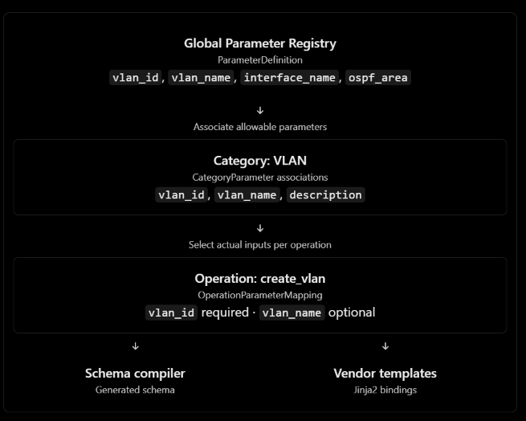
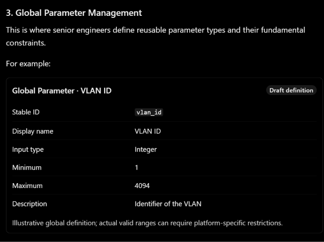
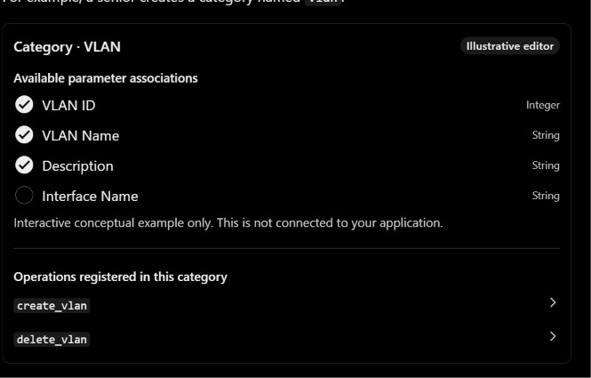
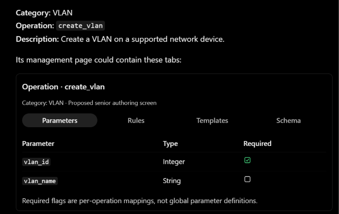
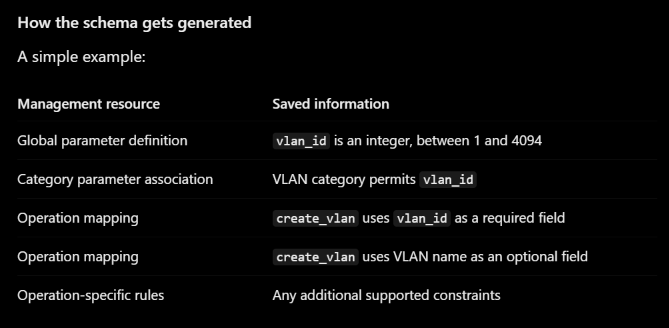

This is a much clearer description of the senior engineer's side of your IDE. And importantly, much of the underlying data architecture you need already exists in V9.
Your AWS analogy is appropriate: instead of making engineers manually maintain a large collection of JSON files, you want them to manage structured engineering resources through separate but interconnected screens.
For example, an AWS administrator can create a security group independently and then associate it with resources. In your application, a senior engineer creates a parameter definition independently, associates it with categories and operations, and lets the system compile the correct schema.
I would make one fundamental architectural decision:
Senior engineers manage knowledge definitions and relationships. Your backend generates schemas. Senior engineers write vendor Jinja2 templates in Monaco, but do not need to write JSON Schema manually.
1. Proposed Knowledge Management structure
Knowledge Management
Proposed senior workspace

Overview

Catalog health, authoring drafts, validation issues, active release

Categories
VLAN, OSPF, BGP, QoS...
Manage category metadata, allowed parameters and operation membership

Operations
create_vlan, configure_ospf...
Select parameter mappings, required flags, rules and vendor support

Global Parameters
VLAN ID, interface name, OSPF area...
Reusable definitions, types, constraints and dependency impact

Template Studio
Cisco / Huawei / Juniper Jinja2
Monaco editor, variables, test rendering and staged changes

Validation & Releases

Compile schemas → check relationships → test templates → review changes → publish approved knowledge

I would provide Category Management, Operation Management and Global Parameter Registry as separate top-level navigation sections, while also allowing engineers to reach related objects through links inside each section.
For example, from the VLAN category page, clicking create_vlan opens that operation directly. From the operation's parameter table, clicking vlan_id opens its global definition.
That is what makes the system behave like a resource-management console rather than a folder of disconnected forms.
2. How the entities should relate
Your proposed relationships map closely to entities already present in the managed V9 knowledge system.

Global Parameter Registry
ParameterDefinition
vlan_id, vlan_name, interface_name, ospf_area

Associate allowable parameters

Category: VLAN
CategoryParameter associations
vlan_id, vlan_name, description

Select actual inputs per operation

Operation: create_vlan
OperationParameterMapping
vlan_id required · vlan_name optional

Schema compiler
Generated schema

Vendor templates
Jinja2 bindings

Your existing V9 analysis documents exactly these managed concepts: ParameterDefinition, CategoryParameter, OperationParameterMapping, OperationSchemaRule and compile_schema(). These were introduced specifically to support shared parameter definitions, operation-specific requirements and engineer-managed schema generation. 00_REPOSITORY_AND_DATA_MAP.md

So we should integrate the GUI with that architecture rather than inventing another knowledge database or another schema-generation engine.

3. Global Parameter Management
This is where senior engineers define reusable parameter types and their fundamental constraints.

For example:
Global Parameter · VLAN ID
Draft definition

Stable ID	vlan_id
Display name	VLAN ID
Input type	Integer
Minimum	1
Maximum	4094
Description	Identifier of the VLAN
Illustrative global definition; actual valid ranges can require platform-specific restrictions.
For the initial version, the parameter editor could support:
Type	Useful constraints
String	Length, pattern, permitted values
Integer	Minimum, maximum, permitted values
Number	Numeric range
Boolean	True/false
Array	Item type, minimum/maximum items, uniqueness
Object	Nested fields and their constraints
The senior engineer fills in structured fields. The system stores a typed parameter definition.
The parameter should not usually have a global required checkbox.
Why? Because a VLAN ID might be required for create_vlan, but optional or inapplicable for another operation.
Requiredness is determined at the operation mapping, which matches how your existing OperationParameterMapping.required is intended to work.
Another important issue is naming collisions. create_vlan.name is a VLAN name, whereas configure_ospf.interfaces[].name is an interface name. They should not accidentally reference the same global definition just because both end in name.
Use stable semantic parameter identities and explicit field paths, as your existing V9 architecture already anticipates.
4. Category Management
A category groups related operations and defines which global parameters are relevant to that domain.
For example, a senior creates a category named vlan.

Category · VLAN
Illustrative editor

Available parameter associations
[x] VLAN ID
Integer

[x] VLAN Name
String

[x] Description
String

[ ] Interface Name
String

Interactive conceptual example only. This is not connected to your application.

Operations registered in this category
create_vlan

delete_vlan

Here is one design choice I strongly recommend:
Category parameters should form the available pool for operations, not automatically become required inputs for every operation.
For example, the category may permit vlan_id, vlan_name, description and interface_name. But create_vlan should use only the relevant subset.
The category association is a relationship and selection constraint. The operation mapping defines the actual schema fields.
This avoids situations where adding a new category-level parameter unexpectedly modifies the schemas of every operation under that category.
If you want a feature where new operations automatically receive suggested parameter mappings, that can be an authoring convenience later—but those suggestions must still be reviewed before saving.

5. Operation Management — where everything comes together
This is probably the most important screen in the senior engineer's workflow.
An operation defines an action that the junior engineer can request from the AI.

For example:
Category: VLAN
Operation: create_vlan
Description: Create a VLAN on a supported network device.
Its management page could contain these tabs:
Operation · create_vlan
Category: VLAN · Proposed senior authoring screen

ParametersRulesTemplatesSchema

Parameter	Type	Required
vlan_id	Integer	
vlan_name	String	
Required flags are per-operation mappings, not global parameter definitions.
The engineer selects an existing global parameter and checks whether that parameter is required for this operation.
There should also be a field-path mapping when necessary. For instance, the global VLAN-name definition may map to the schema property name because that is what the operation's Jinja2 template expects.
This is why OperationParameterMapping is necessary even when you already have global definitions.
How the schema gets generated

A simple example:
Management resource	Saved information
Global parameter definition	vlan_id is an integer, between 1 and 4094
Category parameter association	VLAN category permits vlan_id
Operation mapping	create_vlan uses vlan_id as a required field
Operation mapping	create_vlan uses VLAN name as an optional field
Operation-specific rules	Any additional supported constraints
The schema compiler combines the relevant information into JSON Schema.
The resulting schema is generated and read-only to ordinary engineers. The actual field names and richer metadata must be derived from your real V9 mappings, not from a frontend imitation of the compiler.
That means when an engineer changes an operation mapping from optional to required, the system can generate a different schema without the engineer manually editing JSON Schema.

6. Where should the rules go?
I recommend separating four kinds of validation rather than placing everything into one vague "Rules" screen.
Rule type	Where to manage it	Example
Global parameter constraints	Global Parameter Registry	VLAN ID is an integer in a configured range
Operation schema rules	Operation → Rules tab	At least one of two alternative fields must be provided
Vendor-specific requirements	Operation → Vendor Profile / Template Binding	Cisco and Juniper may require different native inputs
Device/context validation	Existing V9 domain policies	Selected interface must exist on the resolved device
For example, suppose you later manage a configure_static_route operation.
You might want the engineer to specify a next-hop address, an outgoing interface, or an allowed combination of those fields.
A structured rule builder could express a relationship such as:
Conditional rule example
Operation: configure_static_route
At least one of

next_hop
outgoing_interface

Illustrative policy only; the precise valid combinations depend on the supported operation and vendor.
The UI might offer rule types such as "At least one required", "Exactly one required", "Required when", "Allowed values" and "Minimum array items".
But only expose rule types that the existing or extended schema compiler can actually compile and validate.
One important limitation: JSON Schema can check that outgoing_interface is a string, but it cannot by itself determine whether the selected network device possesses that interface.
That belongs to your existing inventory/context validation logic.
The Knowledge Management GUI should reference that policy where appropriate, not pretend every validation is expressible as JSON Schema.